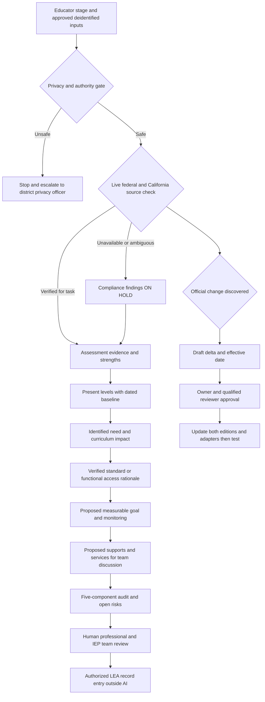

# Workflow and approval map (one specialist, professional modes)

**Note:** `ON HOLD` legal findings cannot turn into compliance assurance merely because an instructional draft is useful. External transmissions, recording, changes to project instructions, cross-project handoffs and publishing require distinct approved actions. No diagram arrow implies an integration is configured.